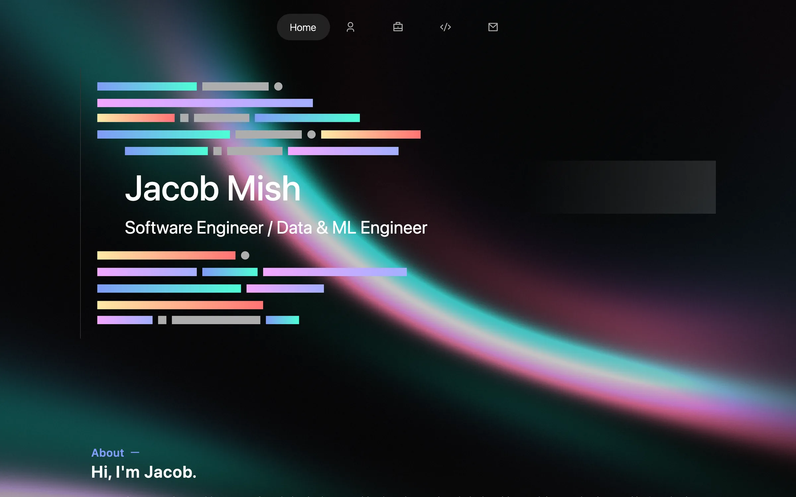
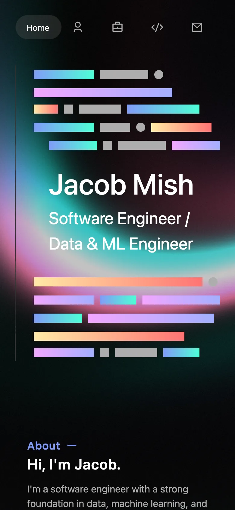
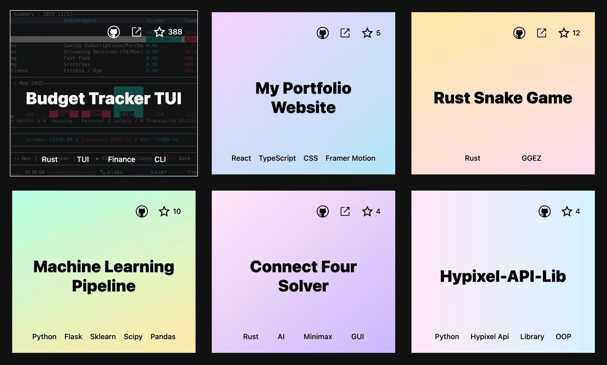
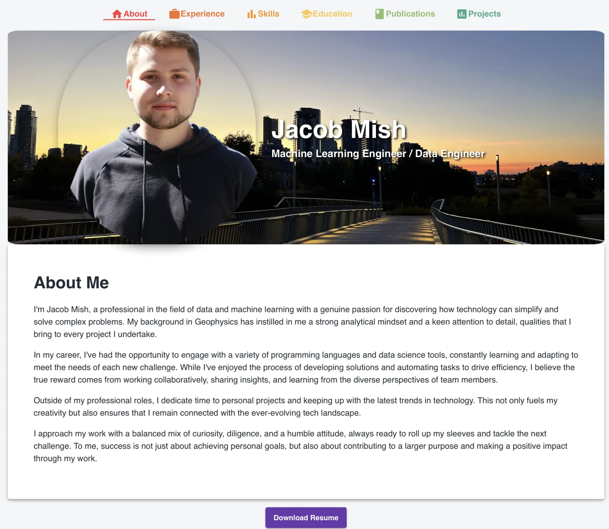

# Design history

## 2024 to 2026

I ran this design from July 2024 to November 2026. I built it with React, TypeScript, Vite, Framer Motion, Three.js, and plain CSS.

<p>
  
  
</p>

Hovering over a project showed its screenshot behind the title.



See the full page on [desktop](2024/desktop-full.webp) or [mobile](2024/mobile-full.webp).

### Run it locally

Check out the 2024 design alongside your current copy.

```sh
git worktree add ../portfolio-2024 54aed98
cd ../portfolio-2024
pnpm install
pnpm dev
```

Back in the main checkout, remove the worktree with `git worktree remove ../portfolio-2024`.

## 2023 to 2024



I built my first portfolio with React, JavaScript, and Material UI. [Visit the site](https://jacobmish-old.netlify.app) or [browse the source](https://github.com/Feromond/jacob-mish-portfolio).
